# AI-Driven Soccer Analysis: a single-camera CV pipeline

*Formerly "TheScript" / Rosco AI*

This pipeline takes match video from one camera and gives a coach stats. It detects and tracks the players and the ball, maps them onto a real-world field, and turns the video into speed, distance, possession, and heatmaps for a D3 college soccer team.

[](https://www.youtube.com/watch?v=HKj34-95-PM)
[](https://www.youtube.com/watch?v=loeXq97BnCw)
[](https://www.youtube.com/watch?v=UKSFIYSSHr8&t=52s)
[](https://universe.roboflow.com/manchado53/keypoint-msoe/dataset/6)
[](https://arxiv.org/abs/2604.08722)

<p align="center">
  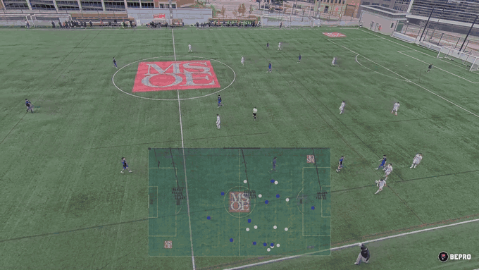
</p>

*Pipeline output on 6 seconds of a game at MSOE. The mini-map shows each tracked player as a dot on a top-down view of the field, blue for one team and white for the other.*

<a href="https://www.youtube.com/watch?v=HKj34-95-PM"></a>
<a href="https://www.youtube.com/watch?v=loeXq97BnCw"></a>

*Click a thumbnail to watch. Left: ball, players and referee tracked with a 2D heatmap. Right: possession, speed and distance stats.*

**Adrian Manchado**, **Tanner Cellio**, and **Jonathan (Jonny) Keane** built this with **Yiyang Wang** (MSOE), for MSOE men's soccer coach **Rob Harrington**.

📄 **Paper:** [*AI Driven Soccer Analysis Using Computer Vision*](https://arxiv.org/abs/2604.08722), Manchado, Cellio, Keane & Wang. arXiv:2604.08722 (cs.CV). Published at MICS (Midwest Instruction and Computing Symposium).

## Highlights

- **One camera, no extra hardware.** A D3 program can't buy a multi-camera tracking system, so we worked from the elevated BePro camera the team already records with.
- **Custom field-keypoint model.** We fine-tuned **YOLOv8x-pose** to find 12 field landmarks. We hand-labeled the dataset, refined it over **6 versions**, and published it on [Roboflow Universe](https://universe.roboflow.com/manchado53/keypoint-msoe/dataset/6).
- **Pixels to meters.** A per-frame homography maps each frame to a 107.79 m × 63.74 m FIFA-standard field. Exponential smoothing (α = 0.8) removes jitter.
- **Detection and tracking stack.** YOLO detects players. **SAM 2** tracks them, and YOLO re-prompts it on occlusion and re-entry. A **Kalman filter** follows the ball, and **K-Means** on jersey color splits teams and referees.
- **Coach-facing outputs.** Speed, distance, off-ball runs, possession by zone, zone occupancy, heatmaps, and an annotated video.
- **Trained on a supercomputer.** Training and inference ran as SLURM jobs on MSOE's **Rosie** cluster (V100, T4, and DGX H100 nodes). See [`scripts/`](scripts/).

## Results (from the paper)

| Piece | Result |
|---|---|
| **Player detection** (benchmarked 4 models as SAM 2 prompts) | **YOLOv5x** chosen: F1 **0.845**, precision 0.896, recall 0.800, IoU 0.764. Beat YOLOv8x (F1 0.845), YOLOv11x (0.783), and Faster R-CNN (0.719). Found 17/22 players with no fine-tuning. |
| **Field keypoints** (custom CNN) | Visibility accuracy **97.2%** on validation (99.9% train). Location error **7.65 px** (0.0138 of image size) on validation. |
| **Full system** (keypoints + homography) | Average projection error **≈ 0.50 m** on the real field. |

The paper lists three known gaps. The detector fires on ball boys and referees. Glare or shadow can flip a player's team color. All keypoint data comes from MSOE's home field. [What didn't work](#what-didnt-work) covers these and what we changed.

<!-- TODO(Adrian): add YOLOv8x-pose keypoint metrics (mAP50 / OKS); the paper's keypoint numbers are for the CNN -->
<!-- TODO(Adrian): add pipeline throughput (frames per second) -->

## Data

| Set | Contents | Source |
|---|---|---|
| **Match footage** | 10 home games from MSOE's 2024 men's season, filmed by an elevated BePro camera that pans and zooms with play. Day, night, and rain games. | Paper, Sec. 3 |
| **Detection ground truth** | 390 consecutive frames. We checked YOLO boxes by hand, used them to prompt SAM 2, and took each mask's bounding box as the label. | Paper, Sec. 3 |
| **CNN keypoint set** | 146 hand-labeled frames from 2 games: 92 with glare on the field, 54 overcast. Most frames show 4 to 12 keypoints. Horizontal flips double the set. | Paper, Sec. 3–4 |
| **YOLOv8x-pose keypoint set** | [`keypoint-msoe` v6](https://universe.roboflow.com/manchado53/keypoint-msoe/dataset/6): 182 images at 1280×720 (147 train, 25 valid, 10 test), COCO keypoint format. | Roboflow export |

**How we built the detection ground truth.** Labeling every player box by hand across 390 frames was too slow, so we let the models draft the labels and kept a human on the final check.

<p align="center">
  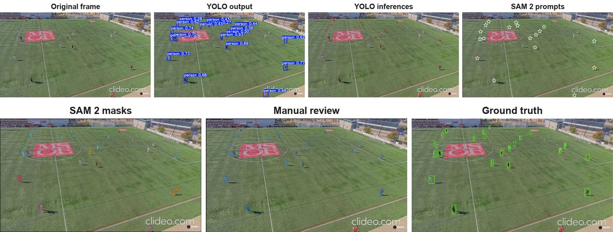
</p>

*Original frame → YOLO boxes → points from each box → SAM 2 prompts → SAM 2 masks → manual review → ground-truth boxes (each mask's bounding box).*

## Pipeline

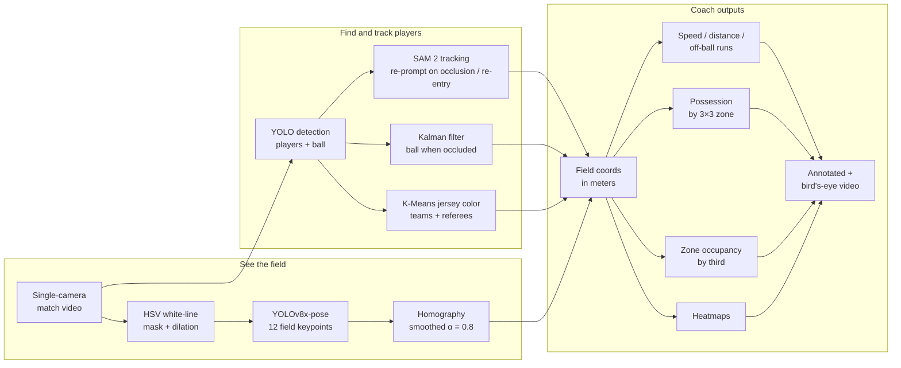

## The pipeline, step by step

### 1. Seeing the field

- **White-line cleanup.** We convert each frame to HSV and keep the white pixels as a binary mask. Dilation thickens the field lines, so the keypoint model still finds them when light and camera conditions change.

<p align="center">
  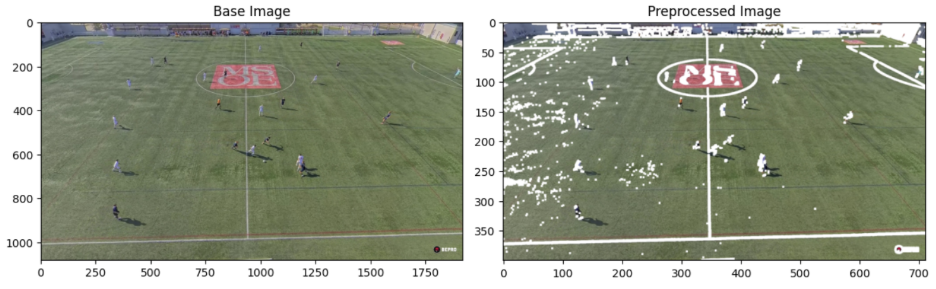
</p>

*Left: raw frame. Right: the same frame after line cleanup, resized to 710×400.*

- **Field keypoints.** A fine-tuned **YOLOv8x-pose** model finds 12 landmarks: 4 on the center circle, 2 where the midfield line meets the touchlines, and 3 on each penalty-box D (center, top and bottom intersections). We labeled frames in Label Studio, converted them to COCO/YOLO format ([`src/transforming_json_keypoints.py`](src/transforming_json_keypoints.py)), and refined the set across **6 dataset versions** on [Roboflow](https://universe.roboflow.com/manchado53/keypoint-msoe/dataset/6).

<p align="center">
  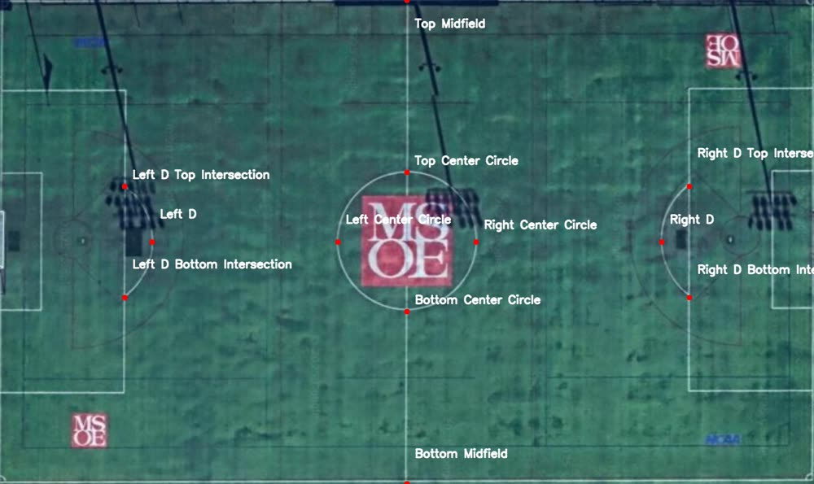
  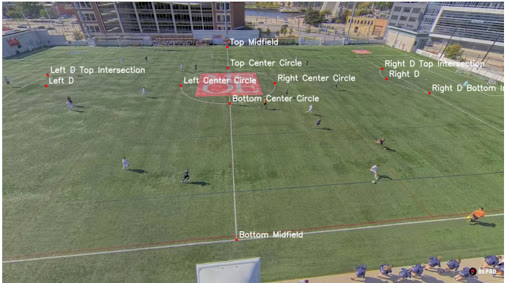
</p>

*Left: the 12 keypoints on a top-down image of the field. Right: one labeled frame from game footage.*

- **CNN baseline.** We also built a **TensorFlow/Keras CNN** with two heads, one for keypoint visibility and one for coordinates, to compare against YOLO-pose ([`src/main_cnn.py`](src/main_cnn.py)). Its loss counts location error on visible keypoints only. Players often stand on a landmark. The visibility head lets the homography step drop a hidden keypoint instead of trusting a bad location.

The coordinate loss is a **masked MAE**. A hidden keypoint is labeled (−1, −1) and gets visibility <i>v</i><sub>i,j</sub> = 0, so it adds nothing to the error:

<p align="center">
  <picture>
    <source media="(prefers-color-scheme: dark)" srcset="docs/media/eq/masked-mae-dark.svg">
    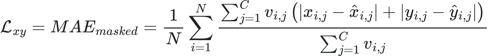
  </picture>
</p>

The visibility head uses binary cross-entropy against the same labels, where <i>p&#770;</i><sub>i,j</sub> is the predicted probability that keypoint <i>j</i> is visible:

<p align="center">
  <picture>
    <source media="(prefers-color-scheme: dark)" srcset="docs/media/eq/visibility-bce-dark.svg">
    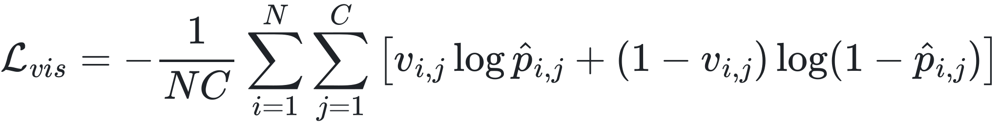
  </picture>
</p>

We train on a weighted sum, with 10 on the coordinate loss and 1 on the visibility loss:

<p align="center">
  <picture>
    <source media="(prefers-color-scheme: dark)" srcset="docs/media/eq/total-loss-dark.svg">
    
  </picture>
</p>

<i>N</i> is the number of images, <i>C</i> = 12 keypoints, (<i>x</i>, <i>y</i>) is the label, and (<i>x&#770;</i>, <i>y&#770;</i>) is the prediction. We trained with Adam and an exponential-decay learning rate, and a Bayesian search tuned dropout, layer sizes, and learning rate.

<p align="center">
  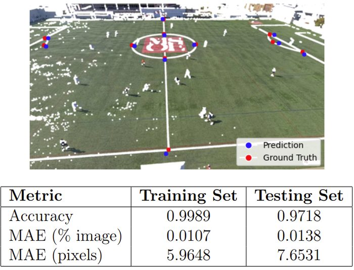
</p>

*Predictions (blue) land on the ground truth (red). On the test set, visibility accuracy is 97.2% and location error is 7.65 px.*

- **Camera-to-field calibration.** We match detected keypoints (pixels) to their known spots on a FIFA-standard field. `cv2.findHomography` returns the pixel-to-meter transform, and exponential smoothing across frames (α = 0.8) stops jitter. With the frame flat, we measure in meters, which section 3 needs for speed and distance.

<p align="center">
  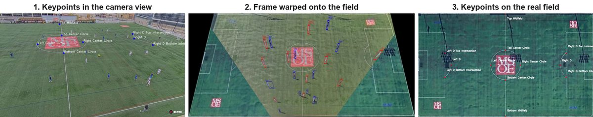
</p>

*1: keypoints found in the camera view. 2: the homography warps the whole frame onto the field. 3: the same keypoints on the real field layout.*

### 2. Finding and tracking players

- **Detection.** YOLO finds the players. We benchmarked four detectors on our ground-truth frames before choosing one, because the detector's boxes become SAM 2's prompts. A player YOLO misses never gets tracked.

<p align="center">
  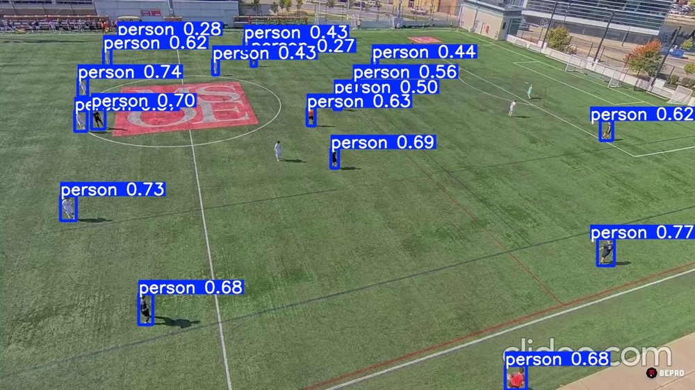
  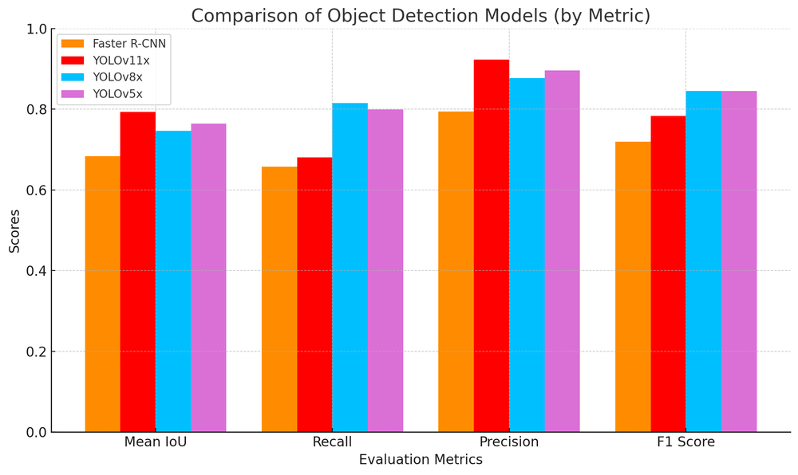
</p>

*Left: off-the-shelf YOLO boxes with confidence scores. Right: the four detectors on mean IoU, recall, precision, and F1. The YOLO models led on F1, and we chose YOLOv5x.*

- **Fine-tuning.** After the benchmark we fine-tuned YOLO on our own frames: players from 125 images (325 after augmentation) and the ball from 218 images (566 after augmentation). The confusion matrices show where it still fails: referees get labeled as players, and the model misses the ball about a third of the time. That 32% miss rate is why we added a Kalman filter for the ball.

<p align="center">
  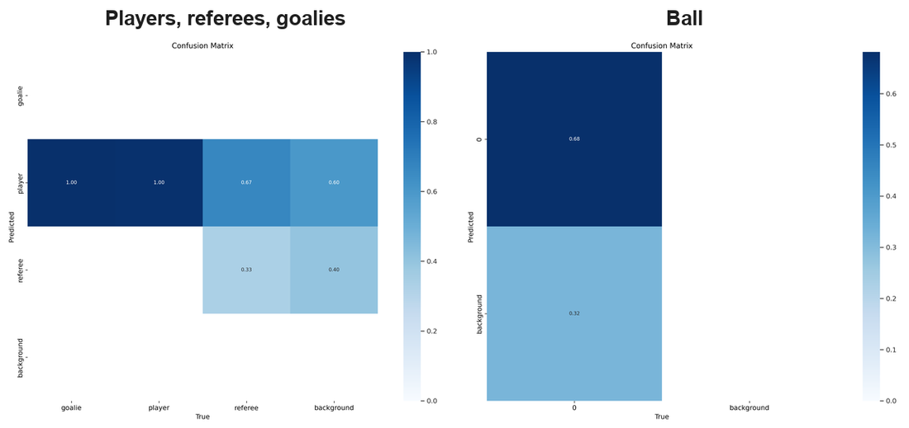
</p>

- **Teams (K-Means).** We cut a patch from the chest of each player's box, average its color, and cluster the averages with **K-Means**. K-Means fits because the number of teams is fixed and it runs fast on every frame. Outlier colors, such as bright yellow, mark referees. To keep the split stable, we average each player's color across frames instead of trusting one frame, and we recalculate the centroids every 200 frames so a change in light (sun to shadow) doesn't flip a team.

<p align="center">
  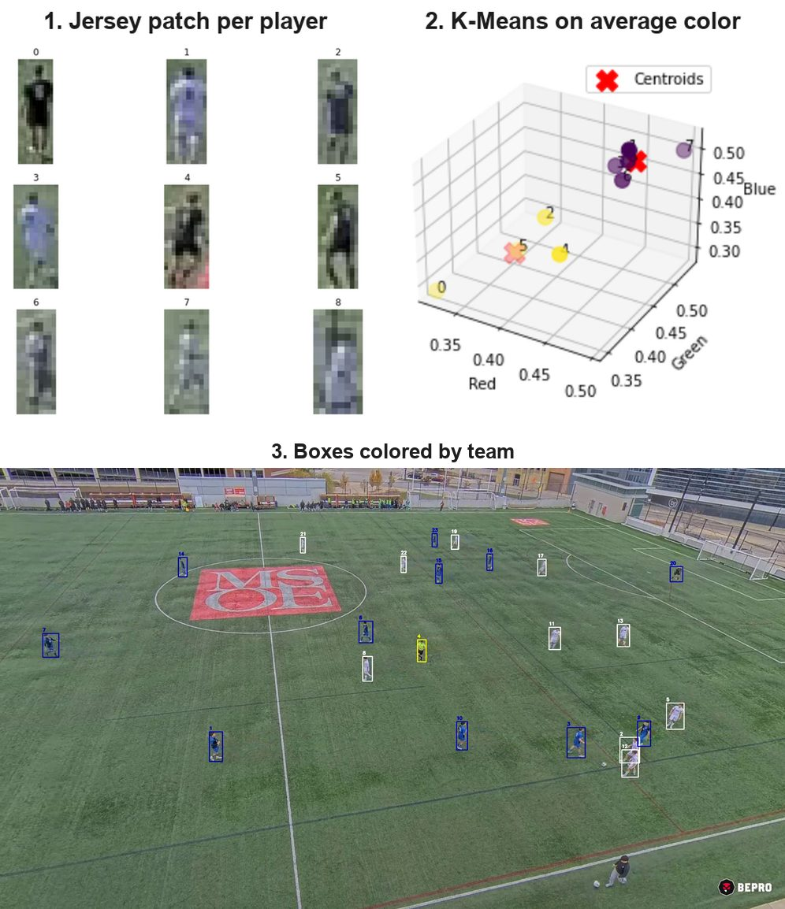
</p>

*1: one crop per detected player. 2: their average colors in RGB space, split into two clusters (the red Xs are the centroids). 3: boxes colored by cluster. Yellow is the referee.*

- **Player tracking (SAM 2).** YOLO has no memory between frames, so a player gets a new identity every frame. **SAM 2** tracks each player under one ID from a single point prompt. YOLO re-prompts SAM 2 to recover the ID after players overlap (by IoU) or a player leaves the frame and comes back.

<p align="center">
  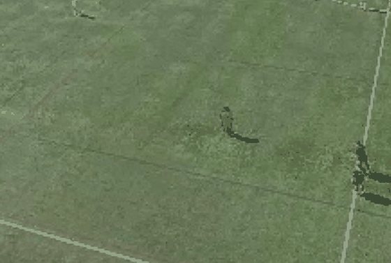
</p>

*SAM 2 follows one player for 280 frames from a single click on frame 0 (sampled every 10th frame).*

- **Ball tracking (Kalman filter).** The ball is small and fast, and it leaves the ground. When YOLO loses it, a **Kalman filter** predicts the next position from the ball's last velocity and trajectory. When YOLO finds the ball again, the filter corrects its estimate with the new measurement.

<p align="center">
  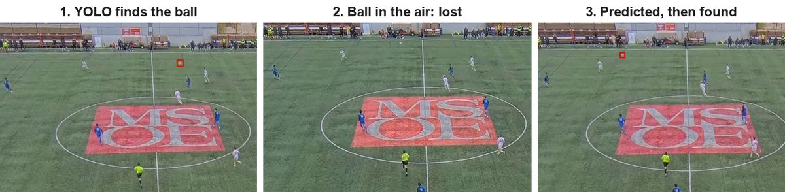
  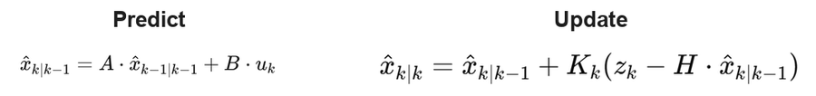
</p>

*Top: the ball is found, lost in the air, and picked up again along the predicted path. Bottom: the two Kalman steps. Predict moves the last state forward. Update blends that guess with the new detection, weighted by the Kalman gain K.*

- **Players on the field.** With teams assigned and keypoints found, the homography from section 1 moves each player's foot position onto the top-down field.

<p align="center">
  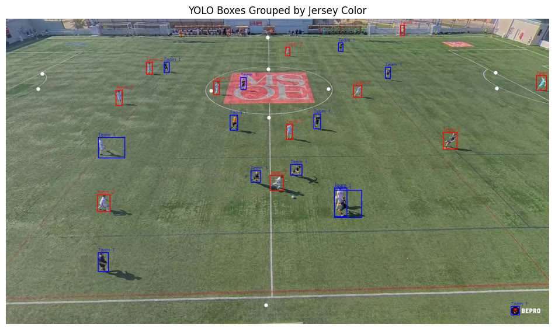
  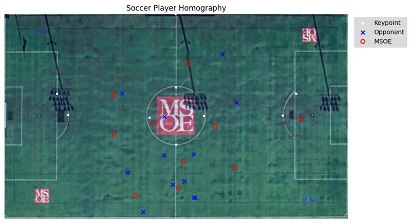
</p>

*Left: YOLO boxes grouped by jersey color (red and blue), with predicted field keypoints as white dots. Right: the same players after homography, on a top-down view of the field.*

### 3. Outputs for the coach

- **Speed** (m/s) and **total distance** (m) per player, from consecutive field positions.
- **Off-ball runs:** high-speed movement without the ball.
- **Possession by zone:** the code splits the field into a 3×3 grid. Each frame, the player closest to the ball (within a radius) gets possession. Output: per-team possession %, overall and per zone.
- **Zone occupancy:** time each team spends in the defensive, middle, and attacking thirds.
- **Heatmaps** of each player's movement.
- **Annotated video:** team-colored player dots, speed and distance labels, a ball marker, and a possession panel. A 2D bird's-eye field view comes with it.

<p align="center">
  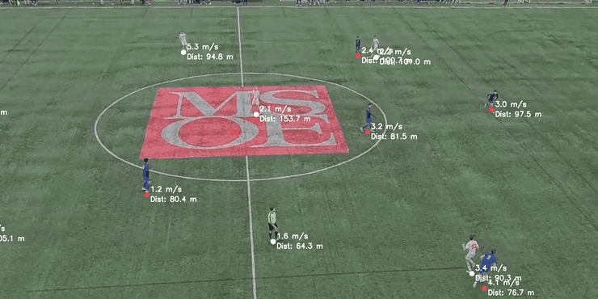
</p>

*Each player carries a speed (m/s) and distance (m) label that updates as play goes on.*

<p align="center">
  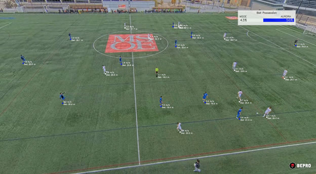
  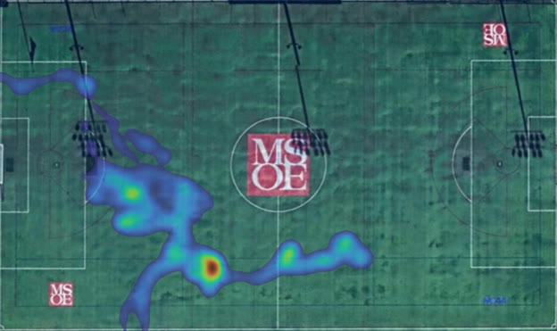
</p>

*Left: annotated frame with a possession panel (MSOE 43%, Aurora 56%). Right: heatmap of one player's positions on the top-down field.*

<p align="center">
  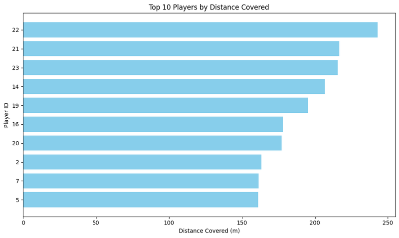
  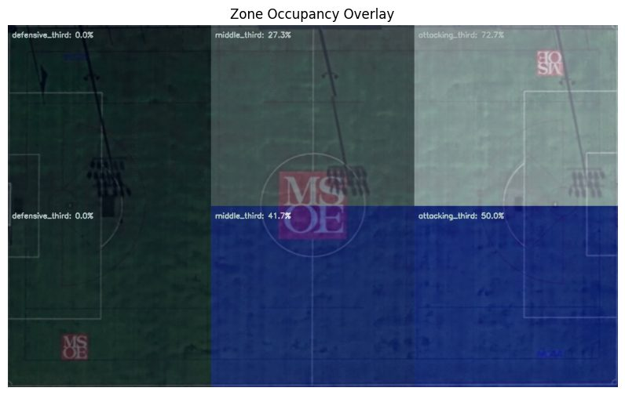
</p>

*Left: the ten players who covered the most ground in the clip. Right: zone occupancy, one row per team, showing how much time each team spent in its defensive, middle, and attacking third.*

## What didn't work

Each of these changed the design.

- **The detector boxes everyone on the field.** YOLO's "person" class boxes ball boys, coaches, and referees along with the players, and each wrong box becomes a wrong SAM 2 prompt. We added a referee class and a jersey-color outlier check. Ball boys still get through.

<p align="center">
  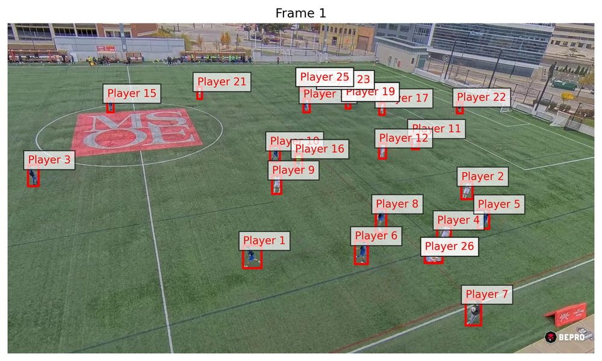
</p>

*"Player 7" is a ball boy on the sideline. The tracker gives the ball boy an ID like everyone else.*

- **SAM 2 is the wrong tool for the ball.** SAM 2 tracks players well because a player is a large shape that changes slowly. The ball is a few pixels wide, moves fast, and leaves the ground. We ruled SAM 2 out for it and used a fine-tuned YOLO ball class plus a Kalman filter instead.
- **SAM 2 is slow.** One mask per player, every frame, is too slow for live use. It works for postgame analysis on a cluster, and it's the first thing to replace (see below).
- **One field.** Every keypoint label comes from MSOE's home field, so the keypoint model hasn't been tested on another stadium's lines or camera angle.

## What I'd do next (production path)

Future work, not yet built:

- **Faster tracking.** SAM 2 works but runs slow. Try a lighter tracker (e.g. ByteTrack / BoT-SORT via `boxmot`) and keep SAM 2 for hard re-ID cases. [`related_works.md`](related_works.md) has the survey behind this.
- **Newer detectors.** Benchmark RF-DETR against the YOLO models for players, ball, and keypoints.
- **Roboflow Workflows.** Chain detection → keypoints → homography → analytics as one hosted, versioned workflow instead of scripts on a cluster.
- **Edge deployment.** Run the pipeline on a small GPU at the field, so the coach gets stats right after the match without uploading footage.
- **Multi-camera.** Add a second camera to cover the far side of the field and cut occlusion.
- **Active learning.** Send low-confidence frames back into the Roboflow dataset for the next labeling round (version 7+).

## Tech stack

**Python · Ultralytics YOLOv8 / YOLOv8-pose · SAM 2 · OpenCV · TensorFlow / Keras · scikit-learn · Albumentations · Roboflow · Label Studio · Matplotlib / Seaborn · SLURM on MSOE Rosie (V100 / T4 / DGX H100)**

**Built with [Roboflow](https://roboflow.com):** the field-keypoint dataset is public on [Roboflow Universe](https://universe.roboflow.com/manchado53/keypoint-msoe/dataset/6) (CC BY 4.0).

## Field geometry

The homography maps to these FIFA-standard measurements:

| Measurement | Value |
|-------------|-------|
| Field length | 107.79 m |
| Field width | 63.74 m |
| Center circle radius | 9.15 m |
| Penalty box width | 40.3 m |
| Penalty box depth | 16.5 m |
| D-line distance from end line | 20.15 m |

## Training

We fine-tuned YOLOv8x-pose on the keypoint dataset (v6) on Rosie:

```bash
sbatch scripts/train_yolo_pose_slurm.sh
```

Config: 100 epochs, batch 16, 640×640 images, mosaic augmentation off, one GPU.

## Running inference

```bash
# On the Rosie cluster
sbatch scripts/run_job.sh

# Or directly
python src/main.py
```

`src/main.py` expects:
- a match video file (e.g. `30SecondsAurora.mp4`)
- player bounding boxes from YOLO + SAM 2 (pickled)
- ball positions from YOLO + Kalman filter (pickled)
- fine-tuned keypoint weights at the path set in [`src/constants.py`](src/constants.py)

## Project structure

```
AI-Driven-Soccer-Analysis/
├── README.md
├── requirements.txt
├── related_works.md                       # Literature survey: production soccer video analytics
├── AI_Soccer_Video_Analysis_Research.pdf  # Research report on scaling the system
│
├── src/
│   ├── main.py                         # Main video pipeline (YOLO-pose keypoints)
│   ├── main_cnn.py                     # Same pipeline with the CNN keypoint baseline
│   ├── constants.py                    # Model path config
│   ├── soccer_util_last.py             # Preprocessing, homography, CNN model, field constants, eval
│   ├── keypoint_model.py               # YOLO pose model wrapper
│   ├── grouping_teams.py               # Player-to-team mapping and colors
│   ├── distance_speed_stimator.py      # Speed / distance / off-ball runs
│   ├── possesion_tracker.py            # Possession by field zone
│   ├── stimating_team_position.py      # Zone occupancy by third
│   ├── heatmap.py                      # Player heatmaps
│   ├── video_creator.py                # Annotated + bird's-eye video rendering
│   └── transforming_json_keypoints.py  # Label Studio JSON -> COCO
│
├── notebooks/
│   ├── FullHomography_03_21_2025.ipynb # End-to-end exploration: keypoints, homography, tracking, analytics
│   ├── TestingSAMInference.ipynb       # SAM 2 tracking experiments
│   └── uploading.ipynb                 # Pull Roboflow datasets + quick inference tests
│
├── scripts/                            # SLURM jobs for Rosie
│   ├── run_job.sh                      # Inference (DGX H100)
│   └── train_yolo_pose_slurm.sh        # YOLOv8-pose training (V100)
│
├── assets/
│   └── viets field.PNG                 # Field diagram used for 2D projection
│
├── docs/media/                         # README images and GIFs
│
├── weights/   (gitignored)             # best.pt, yolov8x-pose.pt, yolov8n-pose.pt, yolov8n.pt
├── data/      (gitignored)             # keypoint-msoe-{1..6} Roboflow datasets
├── logs/      (gitignored)             # SLURM logs
└── runs/      (gitignored)             # YOLOv8 training outputs
```

## Setup

```bash
pip install -r requirements.txt
pip install ultralytics   # YOLOv8; not yet listed in requirements.txt
```

The notebooks add `src/` to their Python path. Open them from the repo root:

```bash
jupyter notebook notebooks/FullHomography_03_21_2025.ipynb
```

`FullHomography_03_21_2025.ipynb` loads pre-computed player boxes and ball positions from `/data/ai_club/SoccerStats2024/` on Rosie.
