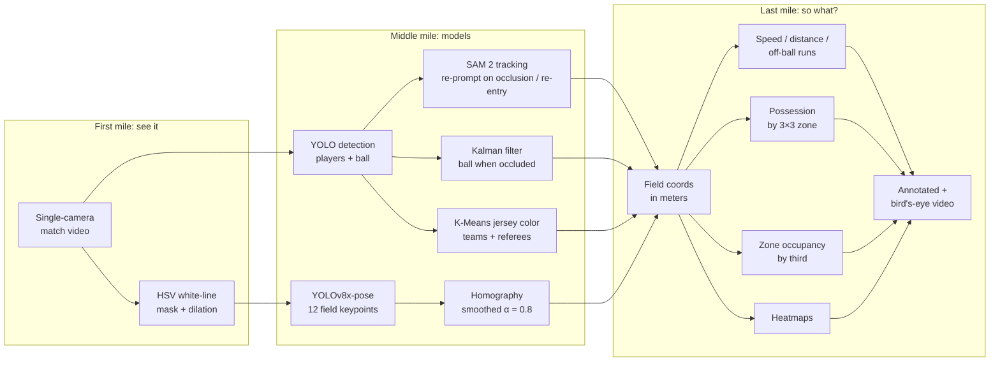

# AI-Driven Soccer Analysis — single-camera CV pipeline

*Formerly "TheScript" / Rosco AI*

**One cheap camera in, coach-ready match analytics out.** Detects and tracks every player and the ball, maps them onto a real-world field, and turns the video into speed, distance, possession, and heatmaps for a D3 college soccer team.

[](https://www.youtube.com/watch?v=HKj34-95-PM)
[](https://www.youtube.com/watch?v=loeXq97BnCw)
[](https://www.youtube.com/watch?v=UKSFIYSSHr8&t=52s)
[](https://universe.roboflow.com/manchado53/keypoint-msoe/dataset/6)
[](paper/AI_Driven_Soccer_Analysis_Using_Computer_Vision.pdf)

<a href="https://www.youtube.com/watch?v=HKj34-95-PM"></a>
<a href="https://www.youtube.com/watch?v=loeXq97BnCw"></a>

*Click a thumbnail to watch. Left: ball, players and referee tracked with a 2D heatmap. Right: possession, speed and distance stats.*

Built by **Adrian Manchado**, **Tanner Cellio**, and **Jonathan (Jonny) Keane**, with **Yiyang Wang** (MSOE), for MSOE men's soccer coach **Rob Harrington**.

📄 **Paper:** [*AI Driven Soccer Analysis Using Computer Vision*](paper/AI_Driven_Soccer_Analysis_Using_Computer_Vision.pdf), Manchado, Cellio, Keane & Wang, MSOE, 2025. Published at MICS (Midwest Instruction and Computing Symposium).

## Highlights

- **Single camera, no special hardware.** Pro-style analytics for a D3 program that can't buy a multi-camera tracking system.
- **Custom field-keypoint model.** Fine-tuned **YOLOv8x-pose** to find 12 field landmarks. The dataset was hand-labeled and refined over **6 versions**, published on [Roboflow Universe](https://universe.roboflow.com/manchado53/keypoint-msoe/dataset/6).
- **Pixels to meters.** Per-frame homography to a 107.79 m × 63.74 m FIFA-standard field, exponentially smoothed (α = 0.8) to remove jitter.
- **Detection + tracking stack.** YOLO detection, **SAM 2** tracking with re-prompting on occlusion and re-entry, a **Kalman filter** for the ball, and **K-Means** jersey-color clustering for teams and referees.
- **Coach-facing outputs.** Speed, distance, off-ball runs, possession by zone, zone occupancy, heatmaps, and an annotated video.
- **Trained on a supercomputer.** Training and inference ran as SLURM jobs on MSOE's **Rosie** cluster (V100, T4, and DGX H100 nodes). See [`scripts/`](scripts/).

## Results (from the paper)

| Piece | Result |
|---|---|
| **Player detection** (benchmarked 4 models as SAM 2 prompts) | **YOLOv5x** chosen: F1 **0.845**, precision 0.896, recall 0.800, IoU 0.764. Beat YOLOv8x (F1 0.845), YOLOv11x (0.783), and Faster R-CNN (0.719). Found 17/22 players with no fine-tuning. |
| **Field keypoints** (custom CNN) | Visibility accuracy **97.2%** on validation (99.9% train). Location error **7.65 px** (0.0138 of image size) on validation. |
| **Full system** (keypoints + homography) | Average projection error **≈ 0.50 m** on the real field. |

Known gaps, called out in the paper: false positives on ball boys and referees, glare or shadow flipping team colors, and keypoint data from only MSOE's home field.

<!-- TODO(Adrian): add YOLOv8x-pose keypoint metrics (mAP50 / OKS) — the paper's keypoint numbers are for the CNN -->
<!-- TODO(Adrian): add dataset size (number of labeled images in keypoint-msoe v6) -->
<!-- TODO(Adrian): add pipeline throughput (frames per second) -->

## The pipeline: first mile → middle mile → last mile

| Stage | Question | What we built |
|---|---|---|
| **First mile** | *Can we even see it?* | One affordable camera. HSV white-line mask + dilation so field lines survive bad lighting. Camera-to-field calibration from detected keypoints + homography. |
| **Middle mile** | *Can the models understand it?* | YOLO player/ball detection · YOLOv8x-pose field keypoints (6 Roboflow dataset iterations) · custom TF/Keras CNN baseline · SAM 2 tracking · Kalman ball filter · K-Means team clustering |
| **Last mile** | *So what? Does a coach use it?* | Speed, distance, off-ball runs, possession by 3×3 zone, zone occupancy by third, heatmaps, annotated + bird's-eye video |



## How each piece works

### First mile: getting a usable signal from one camera

- **White-line enhancement.** Each frame goes to HSV color space. A binary mask keeps white pixels. Morphological dilation thickens the field lines, so keypoints hold up under changing light and camera conditions.
- **Camera-to-field calibration.** Detected keypoints (pixel space) are matched to their known positions on a FIFA-standard field. `cv2.findHomography` gives the pixel→meter transform. It is **exponentially smoothed** across frames (α = 0.8) to stop jitter.

### Middle mile: the models

- **Field keypoints.** A **YOLOv8x-pose** model, fine-tuned to find 12 landmarks: center circle (top, bottom, left, right), midfield line (top, bottom), left/right D-line centers, and left/right D-line top/bottom intersections. Labels were made in Label Studio, converted to COCO/YOLO format ([`src/transforming_json_keypoints.py`](src/transforming_json_keypoints.py)), and refined across **6 dataset versions** on [Roboflow](https://universe.roboflow.com/manchado53/keypoint-msoe/dataset/6).
- **CNN baseline.** A custom **TensorFlow/Keras CNN** with two heads (keypoint visibility classification + coordinate regression), built to compare against YOLO-pose ([`src/main_cnn.py`](src/main_cnn.py)).
- **Player detection and teams.** YOLO finds players. Jersey colors are averaged and grouped with **K-Means**, which splits the two teams. Outlier colors (e.g. bright yellow) flag referees.
- **Player tracking.** YOLO has no memory between frames, so **SAM 2** tracks players and keeps a unique ID for each. When players overlap (detected by IOU), or a player leaves and comes back, YOLO re-prompts SAM 2 to recover the ID.
- **Ball tracking.** The ball is small, fast, and often hidden. When YOLO loses it, a **Kalman filter** predicts its position from velocity and trajectory.

### Last mile: what the coach gets

- **Speed** (m/s) and **total distance** (m) per player, from consecutive field positions.
- **Off-ball runs:** high-speed movement while not in possession.
- **Possession by zone:** the field is a 3×3 grid. Each frame, the closest player to the ball (within a radius) gets possession. Output: per-team possession %, overall and per zone.
- **Zone occupancy:** how much time each team spends in the defensive, middle, and attacking thirds.
- **Heatmaps** of each player's movement.
- **Annotated video:** team-colored player dots, live speed and distance labels, ball marker, and an on-screen possession HUD. Plus a 2D bird's-eye field view.

## What I'd do next (production path)

Future work, not yet built:

- **Faster tracking.** SAM 2 works but is slow. Try a lighter tracker (e.g. ByteTrack / BoT-SORT via `boxmot`) and keep SAM 2 only for hard re-ID cases. See [`related_works.md`](related_works.md) for the survey behind this.
- **Newer detectors.** Benchmark RF-DETR against the YOLO models for players, ball, and keypoints.
- **Roboflow Workflows.** Chain detection → keypoints → homography → analytics as one hosted, versioned workflow instead of scripts on a cluster.
- **Edge deployment.** Run the pipeline on a small GPU at the field, so the coach gets stats right after the match without uploading footage.
- **Multi-camera.** Add a second camera to cover the far side of the field and reduce occlusion.
- **Active learning.** Send low-confidence frames back into the Roboflow dataset for the next labeling round (version 7+).

## Tech stack

**Python · Ultralytics YOLOv8 / YOLOv8-pose · SAM 2 · OpenCV · TensorFlow / Keras · scikit-learn · Albumentations · Roboflow · Label Studio · Matplotlib / Seaborn · SLURM on MSOE Rosie (V100 / T4 / DGX H100)**

**Built with [Roboflow](https://roboflow.com):** the field-keypoint dataset is public on [Roboflow Universe](https://universe.roboflow.com/manchado53/keypoint-msoe/dataset/6) (CC BY 4.0).

## Field geometry

FIFA-standard measurements used as the homography target:

| Measurement | Value |
|-------------|-------|
| Field length | 107.79 m |
| Field width | 63.74 m |
| Center circle radius | 9.15 m |
| Penalty box width | 40.3 m |
| Penalty box depth | 16.5 m |
| D-line distance from end line | 20.15 m |

## Training

YOLOv8x-pose was fine-tuned on the keypoint dataset (v6) on Rosie:

```bash
sbatch scripts/train_yolo_pose_slurm.sh
```

Config: 100 epochs, batch 16, 640×640 images, mosaic augmentation off, one GPU.

## Running inference

```bash
# On the Rosie cluster
sbatch scripts/run_job.sh

# Or directly
python src/main.py
```

`src/main.py` expects:
- a match video file (e.g. `30SecondsAurora.mp4`)
- player bounding boxes from YOLO + SAM 2 (pickled)
- ball positions from YOLO + Kalman filter (pickled)
- fine-tuned keypoint weights at the path set in [`src/constants.py`](src/constants.py)

## Project structure

```
AI-Driven-Soccer-Analysis/
├── README.md
├── requirements.txt
├── related_works.md                       # Literature survey: production soccer video analytics
├── paper/
│   └── AI_Driven_Soccer_Analysis_Using_Computer_Vision.pdf  # Our MICS paper
├── AI_Soccer_Video_Analysis_Research.pdf  # Research report on scaling the system
│
├── src/
│   ├── main.py                         # Main video pipeline (YOLO-pose keypoints)
│   ├── main_cnn.py                     # Same pipeline with the CNN keypoint baseline
│   ├── constants.py                    # Model path config
│   ├── soccer_util_last.py             # Preprocessing, homography, CNN model, field constants, eval
│   ├── keypoint_model.py               # YOLO pose model wrapper
│   ├── grouping_teams.py               # Player-to-team mapping and colors
│   ├── distance_speed_stimator.py      # Speed / distance / off-ball runs
│   ├── possesion_tracker.py            # Possession by field zone
│   ├── stimating_team_position.py      # Zone occupancy by third
│   ├── heatmap.py                      # Player heatmaps
│   ├── video_creator.py                # Annotated + bird's-eye video rendering
│   └── transforming_json_keypoints.py  # Label Studio JSON -> COCO
│
├── notebooks/
│   ├── FullHomography_03_21_2025.ipynb # End-to-end exploration: keypoints, homography, tracking, analytics
│   ├── TestingSAMInference.ipynb       # SAM 2 tracking experiments
│   └── uploading.ipynb                 # Pull Roboflow datasets + quick inference tests
│
├── scripts/                            # SLURM jobs for Rosie
│   ├── run_job.sh                      # Inference (DGX H100)
│   └── train_yolo_pose_slurm.sh        # YOLOv8-pose training (V100)
│
├── assets/
│   └── viets field.PNG                 # Field diagram used for 2D projection
│
├── weights/   (gitignored)             # best.pt, yolov8x-pose.pt, yolov8n-pose.pt, yolov8n.pt
├── data/      (gitignored)             # keypoint-msoe-{1..6} Roboflow datasets
├── logs/      (gitignored)             # SLURM logs
└── runs/      (gitignored)             # YOLOv8 training outputs
```

## Setup

```bash
pip install -r requirements.txt
pip install ultralytics   # YOLOv8; not yet listed in requirements.txt
```

Notebooks add `src/` to their Python path. Open them from the repo root:

```bash
jupyter notebook notebooks/FullHomography_03_21_2025.ipynb
```

`FullHomography_03_21_2025.ipynb` loads pre-computed player boxes and ball positions from `/data/ai_club/SoccerStats2024/` on Rosie.
