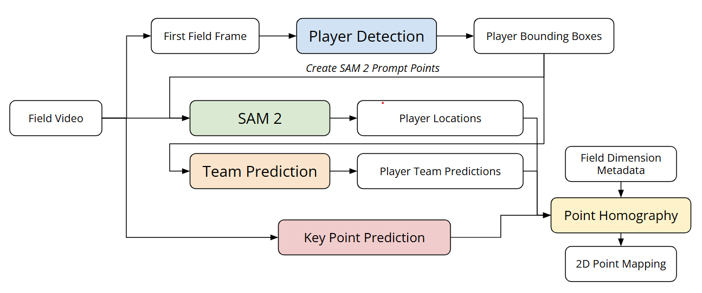
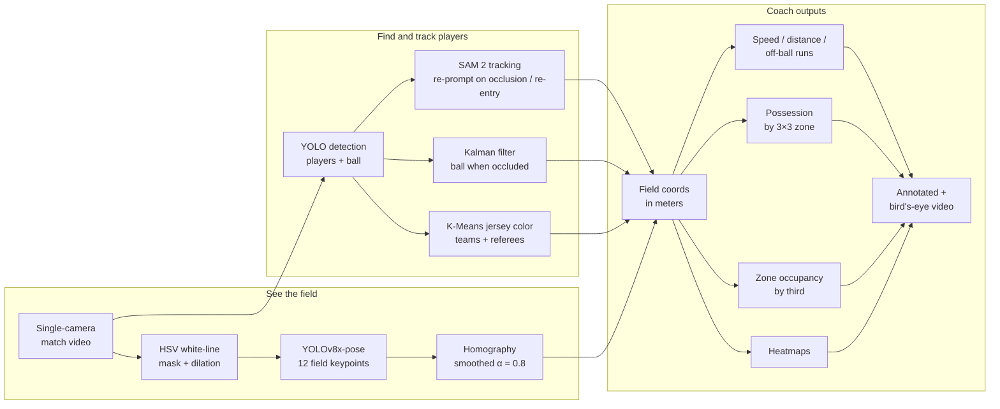

# AI-Driven Soccer Analysis: a single-camera CV pipeline

*Formerly "TheScript" / Rosco AI*

This pipeline takes match video from one camera and gives a coach stats. It detects and tracks the players and the ball, maps them onto a real-world field, and turns the video into speed, distance, possession, and heatmaps for a D3 college soccer team.

[](https://www.youtube.com/watch?v=HKj34-95-PM)
[](https://www.youtube.com/watch?v=loeXq97BnCw)
[](https://www.youtube.com/watch?v=UKSFIYSSHr8&t=52s)
[](https://universe.roboflow.com/manchado53/keypoint-msoe/dataset/6)
[](https://arxiv.org/abs/2604.08722)

<p align="center">
  
</p>

*Pipeline output on 6 seconds of a game at MSOE. The mini-map shows each tracked player as a dot on a top-down view of the field, blue for one team and white for the other.*

<a href="https://www.youtube.com/watch?v=HKj34-95-PM"></a>
<a href="https://www.youtube.com/watch?v=loeXq97BnCw"></a>

*Click a thumbnail to watch. Left: ball, players and referee tracked with a 2D heatmap. Right: possession, speed and distance stats.*

**Adrian Manchado**, **Tanner Cellio**, and **Jonathan (Jonny) Keane** built this with **Yiyang Wang** (MSOE), for MSOE men's soccer coach **Rob Harrington**.

📄 **Paper:** [*AI Driven Soccer Analysis Using Computer Vision*](https://arxiv.org/abs/2604.08722), Manchado, Cellio, Keane & Wang. arXiv:2604.08722 (cs.CV). Published at MICS (Midwest Instruction and Computing Symposium).

## Highlights

- **One camera, no extra hardware.** A D3 program can't buy a multi-camera tracking system, so we worked from the elevated BePro camera the team already records with.
- **Custom field-keypoint model.** We fine-tuned **YOLOv8x-pose** to find 12 field landmarks. We hand-labeled the dataset, refined it over **6 versions**, and published it on [Roboflow Universe](https://universe.roboflow.com/manchado53/keypoint-msoe/dataset/6).
- **Pixels to meters.** A per-frame homography maps each frame to a 107.79 m × 63.74 m FIFA-standard field. Exponential smoothing (α = 0.8) removes jitter.
- **Detection and tracking stack.** YOLO detects players. **SAM 2** tracks them, and YOLO re-prompts it on occlusion and re-entry. A **Kalman filter** follows the ball, and **K-Means** on jersey color splits teams and referees.
- **Coach-facing outputs.** Speed, distance, off-ball runs, possession by zone, zone occupancy, heatmaps, and an annotated video.
- **Trained on a supercomputer.** Training and inference ran as SLURM jobs on MSOE's **Rosie** cluster (V100, T4, and DGX H100 nodes). See [`scripts/`](scripts/).

## Results (from the paper)

| Piece | Result |
|---|---|
| **Player detection** (benchmarked 4 models as SAM 2 prompts) | **YOLOv5x** chosen: F1 **0.845**, precision 0.896, recall 0.800, IoU 0.764. Beat YOLOv8x (F1 0.845), YOLOv11x (0.783), and Faster R-CNN (0.719). Found 17/22 players with no fine-tuning. |
| **Field keypoints** (custom CNN) | Visibility accuracy **97.2%** on validation (99.9% train). Location error **7.65 px** (0.0138 of image size) on validation. |
| **Full system** (keypoints + homography) | Average projection error **≈ 0.50 m** on the real field. |

The paper lists three known gaps. The detector fires on ball boys and referees. Glare or shadow can flip a player's team color. All keypoint data comes from MSOE's home field.

<!-- TODO(Adrian): add YOLOv8x-pose keypoint metrics (mAP50 / OKS); the paper's keypoint numbers are for the CNN -->
<!-- TODO(Adrian): add pipeline throughput (frames per second) -->

## Data

| Set | Contents | Source |
|---|---|---|
| **Match footage** | 10 home games from MSOE's 2024 men's season, filmed by an elevated BePro camera that pans and zooms with play. Day, night, and rain games. | Paper, Sec. 3 |
| **Detection ground truth** | 390 consecutive frames. We checked YOLO boxes by hand, used them to prompt SAM 2, and took each mask's bounding box as the label. | Paper, Sec. 3 |
| **CNN keypoint set** | 146 hand-labeled frames from 2 games: 92 with glare on the field, 54 overcast. Most frames show 4 to 12 keypoints. Horizontal flips double the set. | Paper, Sec. 3–4 |
| **YOLOv8x-pose keypoint set** | [`keypoint-msoe` v6](https://universe.roboflow.com/manchado53/keypoint-msoe/dataset/6): 182 images at 1280×720 (147 train, 25 valid, 10 test), COCO keypoint format. | Roboflow export |

## Pipeline

<p align="center">
  
</p>

*Workflow figure from the paper. Colored boxes are models. White boxes are data.*



## The pipeline, step by step

### 1. Seeing the field

- **White-line cleanup.** We convert each frame to HSV and keep the white pixels as a binary mask. Dilation thickens the field lines, so the keypoint model still finds them when light and camera conditions change.

<p align="center">
  
</p>

*Left: raw frame. Right: the same frame after line cleanup, resized to 710×400.*

- **Field keypoints.** A fine-tuned **YOLOv8x-pose** model finds 12 landmarks: 4 on the center circle, 2 where the midfield line meets the touchlines, and 3 on each penalty-box D (center, top and bottom intersections). We labeled frames in Label Studio, converted them to COCO/YOLO format ([`src/transforming_json_keypoints.py`](src/transforming_json_keypoints.py)), and refined the set across **6 dataset versions** on [Roboflow](https://universe.roboflow.com/manchado53/keypoint-msoe/dataset/6).

<p align="center">
  
  
</p>

*Left: the 12 keypoints on a top-down image of the field. Right: one labeled frame from game footage.*

- **CNN baseline.** We also built a **TensorFlow/Keras CNN** with two heads, one for keypoint visibility and one for coordinates, to compare against YOLO-pose ([`src/main_cnn.py`](src/main_cnn.py)). Its loss counts location error on visible keypoints only.
- **Camera-to-field calibration.** We match detected keypoints (pixels) to their known spots on a FIFA-standard field. `cv2.findHomography` returns the pixel-to-meter transform, and exponential smoothing across frames (α = 0.8) stops jitter.

### 2. Finding and tracking players

- **Detection and teams.** YOLO finds the players. We average each player's jersey color and group the colors with **K-Means** to split the two teams. Outlier colors, such as bright yellow, mark referees.
- **Player tracking.** YOLO has no memory between frames. **SAM 2** tracks each player under one ID. YOLO re-prompts SAM 2 to recover the ID after players overlap (by IoU) or a player leaves the frame and comes back.
- **Ball tracking.** The ball is small and fast, and players hide it. If YOLO loses it, a **Kalman filter** predicts its position from velocity and trajectory.

<p align="center">
  
  
</p>

*Left: YOLO boxes grouped by jersey color (red and blue), with predicted field keypoints as white dots. Right: the same players after homography, on a top-down view of the field.*

### 3. Outputs for the coach

- **Speed** (m/s) and **total distance** (m) per player, from consecutive field positions.
- **Off-ball runs:** high-speed movement without the ball.
- **Possession by zone:** the code splits the field into a 3×3 grid. Each frame, the player closest to the ball (within a radius) gets possession. Output: per-team possession %, overall and per zone.
- **Zone occupancy:** time each team spends in the defensive, middle, and attacking thirds.
- **Heatmaps** of each player's movement.
- **Annotated video:** team-colored player dots, speed and distance labels, a ball marker, and a possession panel. A 2D bird's-eye field view comes with it.

<p align="center">
  
</p>

*Each player carries a speed (m/s) and distance (m) label that updates as play goes on.*

<p align="center">
  
  
</p>

*Left: annotated frame with a possession panel (MSOE 43%, Aurora 56%). Right: heatmap of one player's positions on the top-down field.*

## What I'd do next (production path)

Future work, not yet built:

- **Faster tracking.** SAM 2 works but runs slow. Try a lighter tracker (e.g. ByteTrack / BoT-SORT via `boxmot`) and keep SAM 2 for hard re-ID cases. [`related_works.md`](related_works.md) has the survey behind this.
- **Newer detectors.** Benchmark RF-DETR against the YOLO models for players, ball, and keypoints.
- **Roboflow Workflows.** Chain detection → keypoints → homography → analytics as one hosted, versioned workflow instead of scripts on a cluster.
- **Edge deployment.** Run the pipeline on a small GPU at the field, so the coach gets stats right after the match without uploading footage.
- **Multi-camera.** Add a second camera to cover the far side of the field and cut occlusion.
- **Active learning.** Send low-confidence frames back into the Roboflow dataset for the next labeling round (version 7+).

## Tech stack

**Python · Ultralytics YOLOv8 / YOLOv8-pose · SAM 2 · OpenCV · TensorFlow / Keras · scikit-learn · Albumentations · Roboflow · Label Studio · Matplotlib / Seaborn · SLURM on MSOE Rosie (V100 / T4 / DGX H100)**

**Built with [Roboflow](https://roboflow.com):** the field-keypoint dataset is public on [Roboflow Universe](https://universe.roboflow.com/manchado53/keypoint-msoe/dataset/6) (CC BY 4.0).

## Field geometry

The homography maps to these FIFA-standard measurements:

| Measurement | Value |
|-------------|-------|
| Field length | 107.79 m |
| Field width | 63.74 m |
| Center circle radius | 9.15 m |
| Penalty box width | 40.3 m |
| Penalty box depth | 16.5 m |
| D-line distance from end line | 20.15 m |

## Training

We fine-tuned YOLOv8x-pose on the keypoint dataset (v6) on Rosie:

```bash
sbatch scripts/train_yolo_pose_slurm.sh
```

Config: 100 epochs, batch 16, 640×640 images, mosaic augmentation off, one GPU.

## Running inference

```bash
# On the Rosie cluster
sbatch scripts/run_job.sh

# Or directly
python src/main.py
```

`src/main.py` expects:
- a match video file (e.g. `30SecondsAurora.mp4`)
- player bounding boxes from YOLO + SAM 2 (pickled)
- ball positions from YOLO + Kalman filter (pickled)
- fine-tuned keypoint weights at the path set in [`src/constants.py`](src/constants.py)

## Project structure

```
AI-Driven-Soccer-Analysis/
├── README.md
├── requirements.txt
├── related_works.md                       # Literature survey: production soccer video analytics
├── AI_Soccer_Video_Analysis_Research.pdf  # Research report on scaling the system
│
├── src/
│   ├── main.py                         # Main video pipeline (YOLO-pose keypoints)
│   ├── main_cnn.py                     # Same pipeline with the CNN keypoint baseline
│   ├── constants.py                    # Model path config
│   ├── soccer_util_last.py             # Preprocessing, homography, CNN model, field constants, eval
│   ├── keypoint_model.py               # YOLO pose model wrapper
│   ├── grouping_teams.py               # Player-to-team mapping and colors
│   ├── distance_speed_stimator.py      # Speed / distance / off-ball runs
│   ├── possesion_tracker.py            # Possession by field zone
│   ├── stimating_team_position.py      # Zone occupancy by third
│   ├── heatmap.py                      # Player heatmaps
│   ├── video_creator.py                # Annotated + bird's-eye video rendering
│   └── transforming_json_keypoints.py  # Label Studio JSON -> COCO
│
├── notebooks/
│   ├── FullHomography_03_21_2025.ipynb # End-to-end exploration: keypoints, homography, tracking, analytics
│   ├── TestingSAMInference.ipynb       # SAM 2 tracking experiments
│   └── uploading.ipynb                 # Pull Roboflow datasets + quick inference tests
│
├── scripts/                            # SLURM jobs for Rosie
│   ├── run_job.sh                      # Inference (DGX H100)
│   └── train_yolo_pose_slurm.sh        # YOLOv8-pose training (V100)
│
├── assets/
│   └── viets field.PNG                 # Field diagram used for 2D projection
│
├── docs/media/                         # README images and GIFs
│
├── weights/   (gitignored)             # best.pt, yolov8x-pose.pt, yolov8n-pose.pt, yolov8n.pt
├── data/      (gitignored)             # keypoint-msoe-{1..6} Roboflow datasets
├── logs/      (gitignored)             # SLURM logs
└── runs/      (gitignored)             # YOLOv8 training outputs
```

## Setup

```bash
pip install -r requirements.txt
pip install ultralytics   # YOLOv8; not yet listed in requirements.txt
```

The notebooks add `src/` to their Python path. Open them from the repo root:

```bash
jupyter notebook notebooks/FullHomography_03_21_2025.ipynb
```

`FullHomography_03_21_2025.ipynb` loads pre-computed player boxes and ball positions from `/data/ai_club/SoccerStats2024/` on Rosie.
